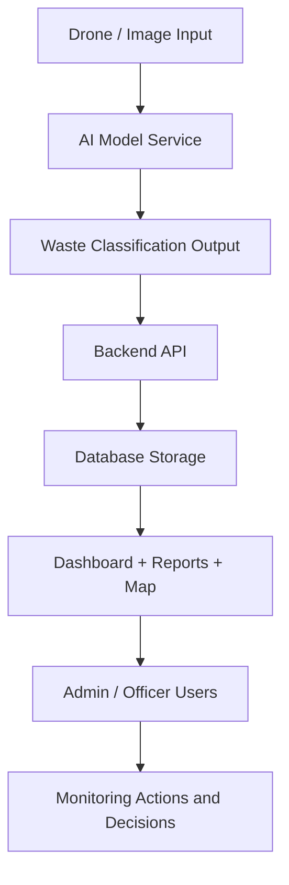

# AI-Based Drone Waste Detection and Geospatial Mapping System for Smart Campus Monitoring

A full-stack solution for detecting, tracking, and managing waste across a campus using drone imagery, AI classification, geospatial mapping, and an administrative monitoring dashboard.

This project combines:
- Computer vision for waste detection
- Drone-based image capture workflows
- GIS mapping and location analysis
- Role-based admin interfaces
- Reporting, analytics, and campus monitoring tools

## Project Overview

The system is designed for smart campus management, helping authorities identify waste hotspots, monitor environmental cleanliness, and manage reporting and maintenance actions efficiently.

### Core goals
- Detect waste from images or drone-captured data using AI
- Classify waste categories and visualize them on a map
- Provide a dashboard for environmental monitoring and decision support
- Allow authorized staff to manage detections, users, reports, and settings
- Support campus-scale analytics and operational reporting

---

## Features

### Smart Waste Detection
- AI-assisted waste classification
- Image-based detection workflows
- Detection metadata such as category, timestamp, and location
- Upload and review workflows for waste records

### Geospatial Monitoring
- Map-based visualization of detections
- Marker-based location tracking
- Filter by category, date, and severity
- Campus-level spatial awareness for waste management

### Admin & Monitoring Dashboard
- KPI cards and activity summary
- Charts for statistical analysis
- Recent detections and activity logs
- Admin tools for users and system settings

### Reports & Analytics
- Report generation and export functionality
- Trend analysis over time
- Waste category summaries
- Actionable insights for campus operations

### Role-Based Access Control
- Administrator role
- Environmental officer role

## Tech Stack

### Frontend
- React + Vite
- Bootstrap / custom CSS
- React Router
- Axios for API communication
- Leaflet for geospatial mapping
- Chart.js for visual analytics

### Backend
- PHP 8
- REST API architecture
- MVC-style structure
- JWT authentication
- Middleware-based access control

### Database
- MySQL
- Structured schema with users, detections, reports, logs, and settings

### AI / ML
- Python-based ML service
- Model inference for waste detection/classification
- Supported for drone/AI augmentation workflows

---

## System Flow



### Typical workflow
1. Drone or campus image data is captured.
2. The ML service processes the image and identifies waste categories.
3. Detection data is sent to the backend API.
4. The backend stores the result and related metadata in the database.
5. The frontend visualizes the detection on the map and dashboard.
6. Authorized users review insights, logs, and reports.
7. Campus staff take action based on the monitored waste patterns.

---

## Project Structure

```text
AI-Based Drone Waste Detection and Geospatial Mapping System for Smart Campus Monitoring/
├── admin/                     # Admin dashboard frontend
├── backend/                  # PHP API + core logic
│   ├── api/
│   ├── config/
│   ├── controllers/
│   ├── core/
│   ├── helpers/
│   ├── middleware/
│   ├── models/
│   ├── routes/
│   └── uploads/
├── database/                 # SQL schema and sample data
├── docs/                     # Architecture and deployment docs
├── frontend/                 # Main frontend app
├── ml_service/               # Python ML service
├── Pictures/                 # Project images/assets
├── colab_upload/             # Colab training-related files
├── README.md                 # Project overview
├── .gitignore                # Git ignore rules
└── LICENSE                   # Optional license file if added
```

---

## Documentation

- [Architecture Guide](docs/ARCHITECTURE.md)
- [Deployment Guide](docs/DEPLOYMENT.md)
- [Database Overview](docs/DATABASE.md)
- [Data Dictionary](docs/DATA_DICTIONARY.md)

---

## Requirements

### Software
- XAMPP / Apache + MySQL
- PHP 8+
- Node.js 18+
- npm 9+
- Python 3.x for the ML service

### Environment Setup
- Start Apache and MySQL
- Import database schema and sample data
- Configure backend database and JWT settings
- Install frontend dependencies
- Run the ML service if AI inference is required

---

## Quick Start

### 1) Database setup
Import the project SQL files from the `database/` folder:

```bash
database/schema.sql
database/sample_data.sql
```

### 2) Backend setup
Configure the database and JWT values in the backend config files, then serve the API through XAMPP or Apache.

```bash
cd backend
```

### 3) Frontend setup
```bash
cd frontend
npm install
npm run dev
```

### 4) Admin panel setup
```bash
cd admin
npm install
npm run dev
```

### 5) Default login
- Admin: `admin@campus.edu` / `password`
- Officer: `officer@campus.edu` / `password`

---

## Role Access

| Role | Access Level |
|------|--------------|
| Administrator | Full access to system settings, users, detections, analytics, and reports |
| Environmental Officer | Access to monitoring, detections, reports, analytics, and settings without user management |

---

## Security Notes

- JWT-based authentication for protected routes
- Role-based authorization for module access
- Prepared SQL queries for database safety
- File upload validation and backend checks
- CORS and middleware protections in API flow

---

## Use Cases

- Campus waste monitoring
- Environmental compliance checks
- Smart city and sustainability insights
- Drone-assisted inspection workflows
- Public campus cleanliness reporting

---

## License

This project is currently shared for academic and project/demo use. Add your project license file if you plan to publish it publicly on GitHub.

---

## GitHub Commit Recommendation

This project is a strong candidate for a GitHub repository with a clear title like:

```text
AI-Based-Drone-Waste-Detection-and-Geospatial-Mapping-System-for-Smart-Campus-Monitoring
```

Suggested commit message:

```bash
git add .
git commit -m "Initial commit: smart campus waste detection and geospatial monitoring system"
```

If you want, I can also help you create:
- a polished project description for GitHub
- a custom system flow section based on your exact workflow
- a final commit message and PR description
- a cleaner README tailored to your presentation/demo

