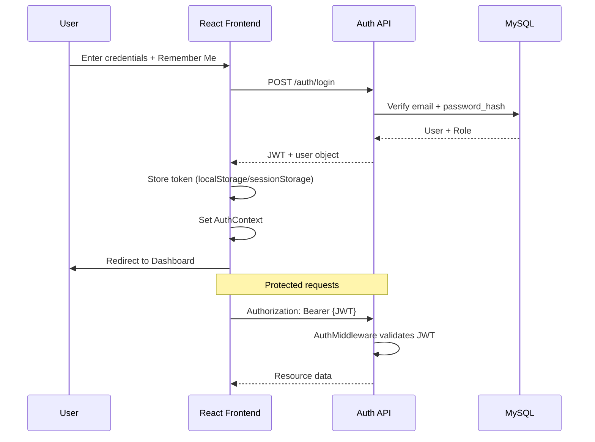
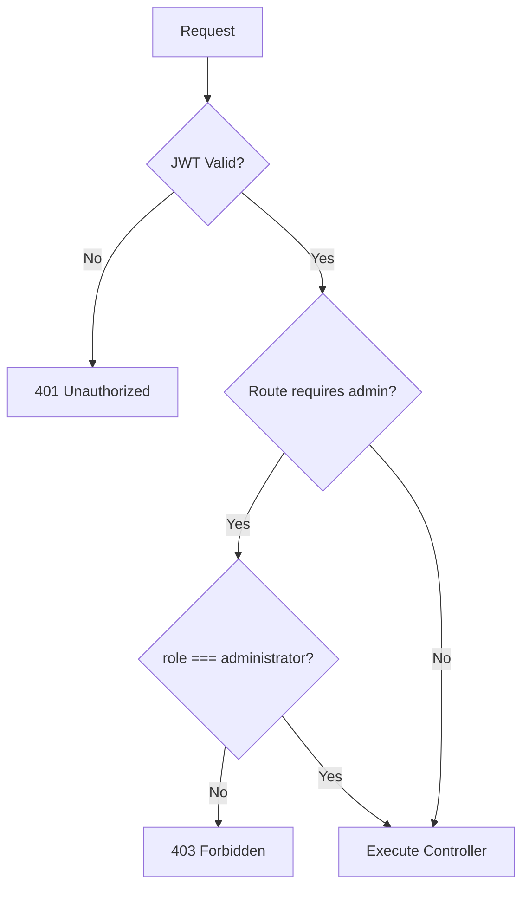

# System Architecture
## AI-Based Drone Waste Detection and Geospatial Mapping System for Smart Campus Monitoring

---

## 1. Complete Folder Structure

```
smart-campus-waste/
├── docs/
│   ├── ARCHITECTURE.md
│   └── DEPLOYMENT.md
├── database/
│   ├── schema.sql
│   └── sample_data.sql
├── backend/
│   ├── api/
│   │   └── index.php              # API entry point
│   ├── config/
│   │   ├── database.php
│   │   ├── app.php
│   │   └── jwt.php
│   ├── controllers/
│   │   ├── AuthController.php
│   │   ├── DashboardController.php
│   │   ├── WasteDetectionController.php
│   │   ├── ReportController.php
│   │   ├── AnalyticsController.php
│   │   ├── UserController.php
│   │   └── SettingsController.php
│   ├── models/
│   │   ├── User.php
│   │   ├── Role.php
│   │   ├── WasteDetection.php
│   │   ├── Report.php
│   │   ├── AnalyticsLog.php
│   │   ├── ActivityLog.php
│   │   └── Setting.php
│   ├── middleware/
│   │   ├── AuthMiddleware.php
│   │   ├── RoleMiddleware.php
│   │   └── CorsMiddleware.php
│   ├── routes/
│   │   └── api.php
│   ├── helpers/
│   │   ├── Response.php
│   │   ├── Validator.php
│   │   └── JwtHelper.php
│   ├── core/
│   │   ├── Router.php
│   │   ├── Controller.php
│   │   └── Model.php
│   └── uploads/
│       └── waste/
├── frontend/
│   ├── public/
│   ├── src/
│   │   ├── components/
│   │   ├── layouts/
│   │   ├── pages/
│   │   ├── services/
│   │   ├── hooks/
│   │   ├── contexts/
│   │   ├── assets/
│   │   └── utils/
│   ├── package.json
│   └── vite.config.js
└── README.md
```

---

## 2. Frontend Architecture

| Layer | Technology | Responsibility |
|-------|------------|----------------|
| **Presentation** | React 18 + Vite | SPA rendering, routing |
| **Styling** | Bootstrap 5 + custom CSS | Responsive UI, theme (#4ADE80) |
| **Routing** | React Router v6 | Public/protected routes |
| **State** | React Context (AuthContext) | JWT, user, role persistence |
| **HTTP** | Axios + interceptors | API calls, token refresh |
| **Maps** | Leaflet + react-leaflet | GIS markers, heatmap, clusters |
| **Charts** | Chart.js + react-chartjs-2 | Dashboard & analytics visuals |

### Frontend Data Flow

```
User Action → Page Component → Service Layer (axios) → PHP REST API
                ↓                                        ↓
         AuthContext ← JWT in localStorage ← JSON Response
```

### Key Frontend Modules

- **Auth**: Login, Forgot/Reset Password, ProtectedRoute
- **Dashboard**: KPI cards, mini-map, Chart.js widgets
- **Waste Detections**: CRUD table, image upload, filters
- **Geospatial Map**: Leaflet layers, popups, filters
- **Reports**: Table, date filters, export triggers
- **Analytics**: Multi-chart dashboard, insights
- **Users**: Admin-only CRUD (role assignment)
- **Settings**: Profile, password, notifications, theme, logs

---

## 3. Backend Architecture

| Layer | Component | Responsibility |
|-------|-----------|----------------|
| **Entry** | `api/index.php` | Bootstrap, CORS, routing |
| **Router** | `core/Router.php` | Method + URI → controller action |
| **Controllers** | `controllers/*` | Request handling, validation |
| **Models** | `models/*` | PDO prepared statements, CRUD |
| **Middleware** | Auth, Role, CORS | JWT verify, RBAC |
| **Helpers** | Response, Validator, JWT | Standardized output |

### MVC Request Lifecycle

```
HTTP Request → index.php → CorsMiddleware → Router
    → AuthMiddleware (if protected) → RoleMiddleware (if admin)
    → Controller::action() → Model → MySQL
    → Response::json() → HTTP Response
```

---

## 4. Database Architecture

### Entity Relationship Overview

- **roles** (1) ──< **users** (N)
- **users** (1) ──< **waste_detections** (N) [detected_by]
- **users** (1) ──< **reports** (N) [generated_by]
- **users** (1) ──< **activity_logs** (N)
- **waste_detections** (1) ──< **reports** (N) [optional linkage via metadata]
- **settings** — key/value store (system + per-user via user_id nullable)

### Indexing Strategy

- `users.email` — UNIQUE login lookup
- `waste_detections(latitude, longitude)` — spatial queries
- `waste_detections.detection_date` — date filters
- `waste_detections.waste_category` — category filters
- `activity_logs.user_id, created_at` — audit trail
- `analytics_logs.metric_type, recorded_at` — analytics aggregation

### Soft Deletes

Applied to: `users`, `waste_detections`, `reports` via `deleted_at` TIMESTAMP NULL.

---

## 5. API Architecture

### Base URL

```
http://localhost/AI-Based%20Drone%20Waste%20Detection%20and%20Geospatial%20Mapping%20System%20for%20Smart%20Campus%20Monitoring/backend/api/
```

### Response Envelope

```json
{
  "success": true,
  "message": "Operation successful",
  "data": {},
  "errors": null
}
```

### Endpoint Groups

| Group | Prefix | Auth |
|-------|--------|------|
| Auth | `/auth/*` | Public (except logout/me) |
| Dashboard | `/dashboard/*` | JWT |
| Waste | `/waste-detections/*` | JWT |
| Map | `/map/*` | JWT |
| Reports | `/reports/*` | JWT |
| Analytics | `/analytics/*` | JWT |
| Users | `/users/*` | JWT + Admin |
| Settings | `/settings/*` | JWT |

---

## 6. Authentication Flow



### JWT Payload

```json
{
  "sub": 1,
  "email": "admin@campus.edu",
  "role": "administrator",
  "role_id": 1,
  "iat": 1710000000,
  "exp": 1710086400
}
```

### Remember Me

- Checked: token + user stored in `localStorage` (7-day JWT expiry)
- Unchecked: `sessionStorage` (session JWT expiry)

---

## 7. Role Management Flow

| Role | Slug | Permissions |
|------|------|-------------|
| Administrator | `administrator` | Full access including User Management |
| Environmental Officer | `environmental_officer` | Dashboard, Detections, Map, Reports, Analytics, Settings (no User Management) |



Frontend: `ProtectedRoute` + `RoleRoute` components hide menu items and block navigation.

---

## 8. Geospatial Mapping Architecture

```
Leaflet Map Container
├── Tile Layer (OpenStreetMap)
├── Marker Cluster Group
│   └── Custom markers by waste_category (color-coded)
├── Heatmap Layer (leaflet.heat)
└── Filter Controls
    ├── Category multi-select
    ├── Date range picker
    └── Location search (lat/lng or place name)

Data Source: GET /map/detections?category=&date_from=&date_to=
```

### Coordinate Storage

- `latitude` DECIMAL(10,8)
- `longitude` DECIMAL(11,8)
- Campus bounding box validated on create/update

### Popup Content

Image URL, category, coordinates, date, time, description — fetched from detection record.

---

## 9. Analytics Architecture

```
Analytics Dashboard
├── Summary API: GET /analytics/summary
├── Trends API: GET /analytics/trends?period=monthly
├── Hotspots API: GET /analytics/hotspots
└── Charts (Chart.js)
    ├── Pie: category distribution
    ├── Bar: detections by zone
    ├── Line: detection frequency over time
    └── Area: monthly trends

Backend aggregates from waste_detections + analytics_logs tables.
Cron/manual: POST /analytics/refresh (admin) — logs snapshot to analytics_logs.
```

---

## 10. Reporting Architecture

```
Report Generation Flow
1. User selects filters (daily/weekly/monthly/custom, category)
2. Frontend: GET /reports?filters
3. Backend: Query waste_detections + aggregate
4. Optional: POST /reports/generate → inserts reports row
5. Export:
   - CSV: streamed response
   - Excel: PhpSpreadsheet (or CSV fallback)
   - PDF: TCPDF/HTML template
```

Report record stores: title, type, date_range, generated_by, file_path (optional), summary JSON.

---

## Security Best Practices

- Password hashing: `password_hash()` / `password_verify()` (bcrypt)
- PDO prepared statements on all queries
- JWT HS256 with secret from config (env in production)
- Input validation via Validator helper
- CORS restricted to frontend origin in production
- File upload: MIME check, size limit, unique filenames
- Activity logging on auth and CRUD mutations
- SQL injection prevention via parameterized queries
- XSS: JSON responses only; frontend escapes user content

---

## Technology Summary

| Tier | Stack |
|------|-------|
| Frontend | React 18, Vite, Bootstrap 5, React Router, Axios, Leaflet, Chart.js |
| Backend | PHP 8, custom MVC, REST, JWT |
| Database | MySQL 8 / MariaDB (XAMPP) |
| Server | Apache (XAMPP) |
